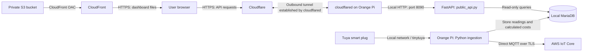

# Hybrid Edge-to-Cloud IoT Smart Plug Monitor

This project uses an **Orange Pi as a local IoT server**, **AWS IoT Core for MQTT telemetry**, and **Amazon S3 with CloudFront to host a web dashboard**. Cloudflare Tunnel connects the public dashboard to an API running on the Orange Pi. Terraform defines and deploys the AWS infrastructure.

I chose this hybrid architecture to reduce recurring cloud usage while making use of my existing Orange Pi. Data collection, electricity-cost calculations, and historical storage run locally. AWS provides the device messaging endpoint and dashboard hosting.

## Architecture



The browser loads the dashboard from CloudFront, then makes separate requests to the Cloudflare API URL. The Orange Pi's MQTT connection to AWS IoT Core is independent of this API connection.

## How it works

### 1. Collect and process readings locally

A Python service on the Orange Pi polls Tuya smart plugs over the local network using `tinytuya`. The Pi processes the readings, calculates estimated electricity costs using the project's configured TNB tariff logic, and stores the results in MariaDB.

Keeping these tasks on the Pi moves the main processing and database workload away from the previous Lambda and DynamoDB architecture. The tariff configuration determines the cost estimate and needs to match the intended billing rules.

### 2. Publish telemetry to AWS IoT Core

The Orange Pi acts as the MQTT client on behalf of the smart plugs. It connects directly to the regional AWS IoT Core endpoint and publishes telemetry to:

```text
Client ID: orange-pi-smart-plug
Topic:     plug/readings
Region:    ap-southeast-1
```

The client uses the AWS root CA to verify the server, plus its device certificate and private key to authenticate to AWS IoT Core. TLS encrypts the connection. AWS documents this certificate-based connection model in its [device communication protocols guide](https://docs.aws.amazon.com/iot/latest/developerguide/protocols.html).

The Terraform configuration creates the IoT Thing, an active X.509 certificate, and an attached policy. That policy permits the client ID above to connect and publish to `plug/readings`; it does not grant subscription or device-control permissions.

AWS IoT Core provides the cloud messaging path. Historical dashboard data comes from MariaDB through the local API; the architecture described here does not require dashboard queries to pass through IoT Core.

### 3. Serve the dashboard from AWS

Terraform uploads `static/index.html` to a private S3 bucket. CloudFront serves the dashboard over HTTPS and uses Origin Access Control (OAC) to access the bucket. The bucket policy restricts object reads to the configured CloudFront distribution.

After the dashboard loads, JavaScript in the user's browser calls the API base URL configured in its `API` variable. The current frontend requests:

| Endpoint | Purpose |
| --- | --- |
| `/devices` | List monitored devices |
| `/summary?device=...` | Retrieve a device summary |
| `/readings?device=...&hours=2` | Retrieve recent readings |

### 4. Read local data through Cloudflare Tunnel

`public_api.py` runs FastAPI on port `8090` on the Orange Pi and, according to the architecture notes, uses read-only database access. A `cloudflared` process, managed by PM2 as `api-tunnel`, establishes an outbound encrypted connection to Cloudflare.

When the browser requests the public API URL, Cloudflare routes the request through that connection to the local FastAPI service. FastAPI queries MariaDB and returns the response through the tunnel to the browser.

## Why I chose Cloudflare

Cloudflare Tunnel makes my home-hosted API reachable without configuring inbound port forwarding on the router or requiring a publicly reachable home IP address. The Orange Pi initiates the connection, which suits a server running behind a home router. See the [Cloudflare Tunnel documentation](https://developers.cloudflare.com/cloudflare-one/networks/connectors/cloudflare-tunnel/).

This lets me keep the database and API on hardware I already own while making the data available to a dashboard hosted on AWS. MariaDB stays local; the tunnel routes requests to the HTTP API. API access controls remain a separate responsibility from tunnel encryption.

The current setup uses a **Quick Tunnel** with a temporary `trycloudflare.com` hostname. It is convenient for development because it requires no domain, but its hostname changes when a new tunnel starts and it has no uptime guarantee. These are documented [Quick Tunnel limitations](https://developers.cloudflare.com/tunnel/get-started/quick-tunnels/).

For a stable deployment, a named tunnel with a configured hostname such as `api.example.com` would remove the need to update the frontend URL after tunnel restarts.

## Why I chose Terraform

Terraform keeps the AWS setup in version-controlled configuration, so I can review changes, reproduce the infrastructure, and understand how resources connect without repeating manual console steps.

| File | What it manages |
| --- | --- |
| `main.tf` | Terraform requirements, AWS provider, and region |
| `iot.tf` | IoT Thing, certificate, publish policy, attachments, and endpoint output |
| `static_site.tf` | S3 bucket, public-access blocking, CloudFront, OAC, bucket policy, and dashboard upload |

The normal deployment workflow, run from the project directory with AWS credentials configured, is:

```bash
terraform init
terraform plan
terraform apply
```

`plan` previews the proposed infrastructure changes, and `apply` carries them out. This follows the [Terraform core workflow](https://developer.hashicorp.com/terraform/intro/core-workflow).

Terraform manages the AWS resources defined in this repository. The Orange Pi services, MariaDB, PM2, and the current Quick Tunnel are configured separately. Device private keys and Terraform state containing certificate material need protected storage.

## Updating the current Quick Tunnel URL

When a tunnel restart changes the public URL:

1. On the Orange Pi, run `pm2 logs api-tunnel` and find the new HTTPS URL.
2. Update the `API` variable in `static/index.html`.
3. Run `terraform plan` and `terraform apply` from the project directory to upload the changed dashboard.
4. Invalidate `/index.html` in CloudFront if the updated page needs to appear immediately; otherwise, allow the cache to expire.

The current Terraform configuration updates the S3 object when the HTML changes, but does not create a CloudFront invalidation.

## Tradeoffs

Moving processing and storage to the Orange Pi reduces the AWS workload, but the Pi now needs ongoing maintenance and database backups. Actual savings depend on usage; AWS messaging, storage, and delivery can still incur charges.

If the Pi or home internet connection is unavailable, CloudFront can still serve the dashboard files, but live API data is unavailable and MQTT publishing stops. Local collection can continue during an internet outage if the Pi, smart plugs, and local network remain operational. Automatic replay of missed cloud messages would require buffering and retry logic beyond what the architecture notes establish.

This design gives me local control over data processing and storage, a certificate-authenticated connection to AWS IoT, and a public dashboard backed by infrastructure I can recreate with Terraform.
